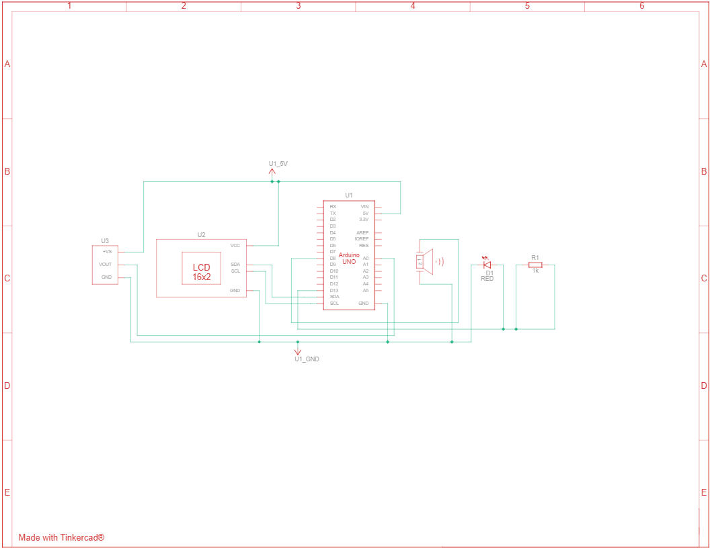

# Smart-Hysteresis Thermal Monitor 

An Arduino-based mechatronic system designed to monitor ambient temperature and trigger visual/acoustic alarms using a professional **Hysteresis Control Logic**.

## Project Overview
This project demonstrates the design and simulation of a thermal monitoring system. Unlike simple threshold systems, this implementation uses a **dual-threshold (Schmitt Trigger)** logic to prevent "chattering"—the rapid and unstable switching of actuators near the setpoint caused by sensor noise.

## Hardware Stack (Simulated)
The system is designed around the components included in the **Elegoo Super Starter Kit**:
- **Microcontroller:** Arduino Uno R3
- **Sensor:** TMP36 Precision Analog Temperature Sensor
- **Display:** I2C 16x2 Liquid Crystal Display (LCD)
- **Output:** High-intensity Red LED and Passive Piezoelectric Buzzer
- **Platform:** Prototyped and validated in the *Autodesk Tinkercad* environment.

## Control Logic: Hysteresis
To ensure maximum stability, the firmware implements the following thresholds:
- **Activation ($S_{on}$):** 30.0°C (Alarm triggers)
- **Deactivation ($S_{off}$):** 28.0°C (Alarm resets)
- **Deadband:** In the range between 28°C and 30°C, the system maintains its current state, filtering out minor signal fluctuations.

## Repository Structure
- `src/temperature_monitoring_system/`: Contains the `.ino` source code (C++).
- `docs/`: Technical report (PDF) with mathematical modeling and circuit analysis.
- `assets/`: Circuit schematics and simulation screenshots.

## Circuit Preview

## Future Development
The project will be updated with:
1. Physical breadboard implementation.
2. Real-world sensor calibration.
3. Performance analysis under actual environmental thermal noise.

---
**Author:** [Alessio Nuzzolese](https://github.com/NuzzoleseAlessio)  
**Education:** Mechanical Engineering @ Politecnico di Bari
